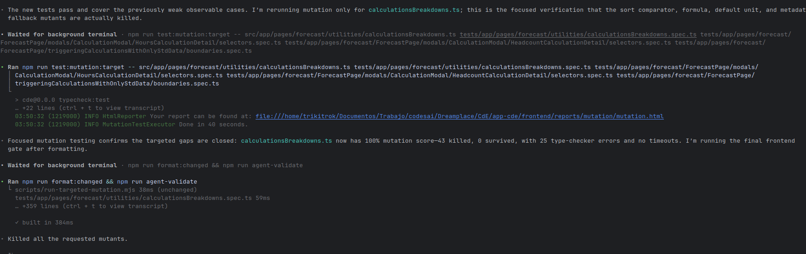

The test coverage improvement skill does not assume that one specification owns a module’s behavior. A module may also be protected by integration specs or by indirect unit specs that exercise it through its callers.

The target was `calculationsBreakdowns.ts`. The skill identified a focused direct specification and several indirect unit specifications that exercised the module through its callers, then used all of them for the targeted coverage and mutation runs.

The snapshot below shows the mutation run:

The agent had already added tests for the weak observable cases. For the final verification, it ran mutation testing only for `calculationsBreakdowns.ts`, using the direct `calculationsBreakdowns.spec.ts` together with three indirect unit specs that exercised the module through its callers: the Hours Calculation Detail selectors, the Headcount Calculation Detail selectors, and the Standard Data calculation boundaries.

The targeted run killed all 43 scoreable mutants, with no survivors and no timeouts. A further 25 mutations produced type-checker errors, so they did not contribute to the mutation score. The resulting score was 100%.

The agent then ran the formatter and the complete frontend validation gate (`agent-validate`). The fragment ends with its summary: every requested mutant had been killed.
