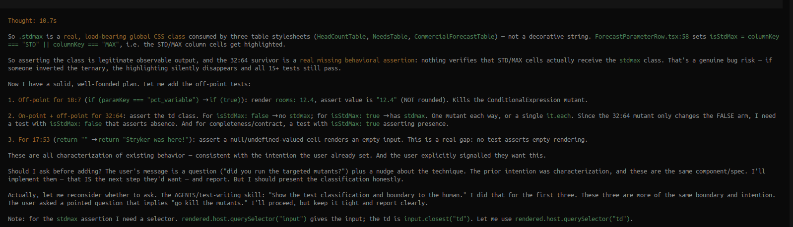
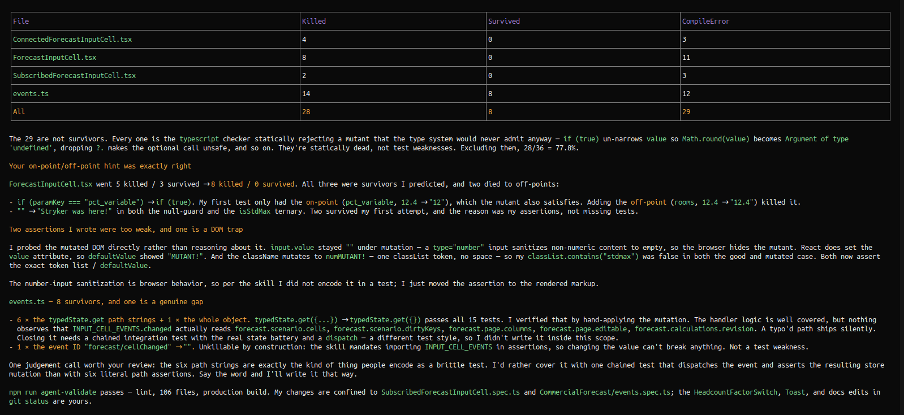

In this session, OpenCode initially decided that covering the branch was enough and was having problems killing some relevant mutants because it was ignoring the **off-points**, so I nudged it with this prompt:

> the on-point off-point thing is useful sometimes to kill mutants, did you run the targeted mutants after improving the coverage?

This snapshot shows its reasoning about the **on-point** and **off-point** concepts from **Boundary Value Analysis** (BVA):

Once it reran targeted mutation testing, the surviving mutants separated into two groups: some showed genuine weaknesses in the tests; another came from an unreachable branch and was not relevant to improving test protection. 

For the relevant survivors, adding **off-points** around several boundaries made the mutated and original behavior observably different, killing some of the mutants.

This second snapshot is OpenCode’s final assessment. It explicitly recognizes that the BVA hint was useful: “Your on-point/off-point hint was exactly right.”

It also explains which mutants the new **off-point** cases killed and identifies the irrelevant survivor separately.

