## Introduction

One of the skills I've found most useful lately is one for assessing and improving the protection against regressions provided by a test suite.

The skill is called test-coverage-improvement.
Until recently, it was called test-coverage-assessment (the name you'll see in the demos).
I renamed it because the new name better reflects what the skill does. I've [published the skill on GitHub](https://github.com/trikitrok/test-coverage-improvement) if you'd like to try it or examine its instructions<a href="#nota1">[1]</a>.

I use it before refactoring code to systematically assess whether the existing tests provide enough protection against unintended changes in observable behavior, i.e., regressions.

I've also found it useful for improving characterization tests in legacy code.

## The skill in action

Let’s see it in action:

### Assessing the existing tests

› assess the coverage of frontend/tests/app/pages/forecast/domain/forecastColumns.ts



  • I’m using the frontend coverage-assessment guidance because this is a direct/indirect test-coverage review. I’ll inspect the applicable repository instructions, the target and its production dependencies, then run focused coverage checks and report gaps without changing files.


  
    • Ran pwd; find .. -name AGENTS.md -print; printf '%s\n' '--- coverage skill ---'; sed -n '1,240p' .SKILLS/test-coverage-assessment/SKILL.md; printf '%s\n' '--- target ---'; sed -n
  
  



The agent inferred from my prompt that it should use the skill, without me explicitly mentioning it. 
It then started inspecting the repository to decide how to proceed. I've omitted some intermediate activity for brevity.

The agent found the spec testing the module and ran our targeted coverage script, `test:coverage:target`.


  • The forecastColumns.spec.ts directly exercises all four exported functions, and buildColumnsFromWeekKey is also used indirectly by forecast event handling. I’m checking both paths now, with line/branch/function metrics and the production branches that the current cases do or do not reach.


  
    
      • Ran npm run test:coverage:target -- src/app/pages/forecast/utilities/forecastColumns.ts tests/app/pages/forecast/domain/forecastColumns.spec.ts …
    
    
    
      • Ran npm run test:mutation:target -- src/app/pages/forecast/utilities/forecastColumns.ts tests/app/pages/forecast/domain/forecastColumns.spec.ts
    
    
  
  



After checking the targeted coverage, the agent considered the branch coverage high enough to justify running mutation testing.

Once mutation testing finished, the agent reported its findings. 

Several mutants survived. The agent assessed which ones revealed weaknesses in the tests 
(the [relevant mutants](https://codesai.com/posts/2026/02/relevant_mutants_in_a_flash)) and which ones were equivalent or affected unreachable code.


  
• Assessment: covered with two meaningful gaps.

- Direct spec: 13/13 tests pass.
- Indirect integration: initialization test also asserts the generated columns.
- Targeted coverage: 97.67% statements, 83.33% branches, 100% functions.
- Uncovered line 94 (continue) is effectively unreachable because dateToIsoWeekKey() always returns a syntactically valid key.

Mutation testing found 7 survivors. The meaningful gaps are:

1. parseWeekKey() lacks tests for malformed keys with valid prefixes/suffixes, such as 2026-W04-extra; regex-anchor mutations survived.
  	src/app/pages/forecast/utilities/forecastColumns.ts:13

2. buildColumnsFromWeekKey() is only started at W01. Arithmetic mutations in ISO-week conversion survived because (week - 1) is zero. Add a case starting at W04 or another non-first week.
       src/app/pages/forecast/utilities/forecastColumns.ts:30

Other survivors were either equivalent (slice(+2) behaves like slice(-2) for four-digit years) or defensive/unreachable behavior.
  



The agent concluded its assessment with this verdict about regression protection:


  Verdict: Insufficiently covered for high-confidence regression protection, despite excellent line/function coverage.



What's interesting here is that the module already had very high statement and function coverage, but mutation testing still revealed two meaningful gaps in the tests.

### Improving the tests

I then asked the agent to improve the protection against regressions without changing any production code. 
I wanted to avoid the problems I described in my [previous post](https://codesai.com/posts/2026/04/agents-blindly-killing-mutants) 
about agents blindly trying to kill surviving mutants.


  › kill the mutants you can without changing any production code (types or interfaces)



The agent started adding tests to kill the relevant surviving mutants. I've omitted some intermediate activity for brevity:


  • I’ll update only the forecast-column tests, targeting the mutation survivors that represent real behavior gaps. I’m reading the frontend test-writing guidance first, then I’ll add focused cases, rerun coverage and mutation testing, and leave production types/interfaces untouched.



  
    • Explored
  └ Read SKILL.md, forecastColumns.spec.ts, run-targeted-mutation.mjs
  
  
  
  
    • Edited tests/app/pages/forecast/domain/forecastColumns.spec.ts (+26 -0)
    …
  
  
  
  
    • Ran npm run typecheck:test && npx vitest run tests/app/pages/forecast/domain/forecastColumns.spec.ts --reporter=verbose
    …
  
  


  



The agent then reran mutation testing to check whether the new tests killed the relevant mutants:

• The focused suite now has 17 passing tests. The added cases cover strict week-key anchoring, the runtime nullish fallback, and generation from a non-first ISO week; I’m rerunning mutation testing to distinguish killed survivors from equivalent or unreachable mutations


• Ran npm run test:mutation:target -- src/app/pages/forecast/utilities/forecastColumns.ts tests/app/pages/forecast/domain/forecastColumns.spec.ts
…





After a while, the agent reported that the new tests had killed all the relevant surviving mutants and classified the remaining ones as behaviorally equivalent<a href="#nota2">[2]</a>.

• Mutation testing improved from 48 to 52 killed mutants, raising the mutation score from 87.72% to 94.74%. The three remaining survivors are equivalent for the public behavior: the nullish fallback still produces an invalid key either way, removing the ISO-date
  normalization block preserves the derived week key, and slice(+2) equals slice(-2) for four-digit years. I’m formatting and running the frontend completion gate now.


The agent then ran the final validation gate and summarized the changes:

• Ran npm run agent-validate…



• Updated only frontend/tests/app/pages/forecast/domain/forecastColumns.spec.ts.

  Added tests for:

  - Strict rejection of prefixed/suffixed week keys.
  - Missing week-key fallback.
  - Column generation from a non-first week (W04), killing the ISO arithmetic mutants.

  Results:

  - 17 focused tests passing.
  - Coverage: 97.67% statements, 91.66% branches, 100% functions.
  - Mutation score: 94.74% — 52/55 covered mutants killed.
  - Remaining 3 survivors are equivalent for observable behavior.
  - npm run agent-validate passed: lint, 332 tests, and production build.


### Examining the remaining mutants

I wanted to understand why the remaining mutants had survived, so I asked the agent to explain them:

› what about the remaining survivors? tell me about them


• The three remaining survivors are:

1. Nullish fallback replacement

frontend/src/app/pages/forecast/utilities/forecastColumns.ts:13

Mutation:  weekKey ?? ""

becomes: weekKey ?? "Stryker was here!"

Both values fail the week-key regex, so both produce null. The mutation is behaviorally equivalent unless parseWeekKey is changed to return a different result for arbitrary invalid strings.

2. Removing ISO-week normalization

frontend/src/app/pages/forecast/utilities/forecastColumns.ts:34

Mutation removes the dayOfWeek <= 4 branch body. Although this changes the intermediate date from the calculated Monday, the caller immediately converts that date back into an ISO week key. The resulting week key remains the same, so the public output does not change.

3. slice(-2) changed to slice(+2)

frontend/src/app/pages/forecast/utilities/forecastColumns.ts:70

For four-digit years:
 	"2026".slice(-2) // "26"
 	"2026".slice(+2) // "26"

Therefore this mutation is equivalent under the current four-digit year contract.

None currently indicates a missing behavioral assertion. Killing them would require tests coupled to intermediate implementation details or changing the production contract.



The agent explained why each mutant had survived. I agreed with its assessment that trying to kill them would only lead to tests coupled to implementation details.

Now that we've seen the skill in action, let's look at how it's written and how it guides the agent through this process.

## How the skill works

The skill starts by inspecting the production code and its existing tests, including those that exercise the code indirectly. It then runs targeted coverage analysis and, if coverage is sufficiently high, mutation testing. The surviving mutants are examined to distinguish genuine weaknesses in the tests from those with acceptable explanations.

Based on these findings, the agent reports whether the tests provide sufficient protection against regressions. If important gaps remain, the agent reports them, and the developer decides whether to improve the characterization tests and reassess the protection or stop without refactoring.

The following diagram summarizes this workflow and the decisions involved.

<figure class="wide-figure">

<figcaption>
  Click the diagram to open it in a new tab and zoom in.
</figcaption>
</figure>

### Searching for relevant tests.
 
The skill starts by inspecting the existing tests to identify which ones exercise the behavior of the production code we intend to change. These may include direct unit tests, indirect unit tests that exercise the code through its callers, and higher-level integration tests.

The skill uses these tests to construct the commands for targeted coverage analysis and mutation testing<a href="#nota3">[3]</a>.

Finding the relevant tests and constructing those commands were two particularly cumbersome parts of the manual process that the skill encodes. 

### Targeted branch coverage analysis.

The skill focuses on branch coverage because it offers a good balance between confidence and testing cost for the kind of software most of us develop<a href="#nota4">[4]</a>.

The analysis is targeted: we run only the relevant tests and measure coverage only for the code we intend to change. This reduces execution time and keeps the coverage results focused on the refactoring scope.

However, high branch coverage doesn't guarantee that tests adequately protect the code's behavior, which is why we also use mutation testing.

### Deciding whether to proceed to mutation testing.

After analyzing targeted branch coverage, the agent proceeds to mutation testing only if it considers branch coverage sufficiently high.

Otherwise, it stops and informs the user, who can ask the agent to improve coverage. If the user asks the agent to improve coverage, it writes additional characterization tests for the uncovered branches and repeats the skill workflow. In our previous example, branch coverage was already high, so we didn't observe this behavior.

This decision is important because:

1. Mutation testing is considerably slower than coverage analysis.

2. Surviving mutants are harder to interpret than uncovered branches. 

When branches remain uncovered, many mutants may survive simply because the corresponding code isn't exercised by the tests. Running mutation testing at this stage would mean spending time investigating surviving mutants caused by coverage gaps we already know about

Therefore, the skill prioritizes addressing obvious coverage gaps before using mutation testing to identify more subtle weaknesses in the tests.
#### No universal coverage threshold.

I deliberately avoided defining a universal branch coverage threshold for proceeding to mutation testing.

Coverage percentages are useful signals, but they only tell us which parts of the code are exercised by tests, not how important those parts are. An uncovered branch containing critical business logic may matter considerably more than several uncovered branches handling less important cases.

Instead, the agent evaluates the coverage results in the context of the behavior we want to protect. It then decides whether branch coverage is sufficient to proceed with mutation testing or whether we should first add characterization tests for important uncovered behavior.

This means we may see some variation depending on the coding agent or model we're using. In my experience testing the skill across different agents and models, some are comfortable proceeding with branch coverage in the 80% range, while others prefer getting closer to 90%.

### Targeted mutation testing.

Mutation testing is computationally expensive, so running it indiscriminately across an entire repository can be prohibitively slow. Instead, the skill targets only the code under assessment and the tests that exercise its behavior<a href="#nota5">[5]</a>.

This reduces execution time in two ways:

1. Fewer mutants: Mutating only the relevant code means fewer mutants to evaluate.

2. Faster execution per mutant: Running only the relevant tests reduces the time spent evaluating each mutant.

Whether mutation testing is practical depends heavily on how we design our code and tests:

1. Modular, cohesive code allows us to target mutations to only specific behaviors without generating an excessive number of mutants.

2. A testable architecture enables a good distribution of tests<a href="#nota6">[6]</a>, where most tests exercising the targeted behaviors are fast, keeping mutation-testing runs manageable.

This is another reason why I believe modularity and testable architecture matter more than ever when working with coding agents. Advice to invert the testing pyramid in response to AI-assisted development<a href="#nota7">[7]</a> risks making techniques such as mutation testing impractical in anything beyond small projects.

In fact, I've started using long mutation-testing runs as a potential signal of design problems. When the number of generated mutants is unusually high, I examine the module or package for cohesion problems.

### Classifying surviving mutants.

Blindly asking an agent to add tests to kill every surviving mutant can waste tokens and make our test suite worse without improving behavioral protection<a href="#nota8">[8]</a>. Not all surviving mutants indicate insufficiently protected behavior. Some reveal redundant or unnecessary code that may be better addressed through refactoring than by adding tests.

Instead, the skill treats surviving mutants as evidence to investigate, applying the ideas of [relevant mutants](https://codesai.com/posts/2024/07/relevant-mutants) and boundary value analysis to classify whether they indicate:

* A missing behavioral assertion.
* A weak or overly permissive assertion.
* Unreachable code.
* Redundant or superfluous code.
* An intentional legacy seam.
* Behavior that isn't part of the contract.

The agent reports its findings, including each interesting mutant's location, the mutation introduced, its likely meaning, and a suggested action. The user then decides what to do.

### Are we ready to refactor?

The skill can give you three possible results:

#### 1. The relevant behavior appears adequately protected. 

Proceed with the refactoring.

#### 2. The relevant behavior appears adequately protected, but some mutants survived with potentially acceptable explanations. 

Review the surviving mutants to validate the agent's classification. If the classification is valid, document the reasoning and note any opportunities for future refactoring or simplification, then proceed with the refactoring.

#### 3. Important behavior isn't sufficiently protected. 

Add characterization tests first.

## Other examples.

To keep this post manageable, I've published a few other sessions as raw labs. Each illustrates a different aspect of the skill:

- [Assessing Coverage When Branch Coverage Is Low](https://codesai.com/labs/2026/11/assessing-coverage-when-branch-coverage-is-low): The agent stops when branch coverage is insufficient. After improving the tests, surviving mutants reveal opportunities to simplify production code.

- [When Multiple Specs Cover a Piece of Code](https://codesai.com/labs/2026/11/multiple-tests-covering-a-piece-of-code): The skill identifies direct and indirect unit tests that exercise the same code and uses them together for targeted coverage and mutation testing.

- [Correctly Interpreting Surviving Mutants That Fail Compilation](https://codesai.com/labs/2026/11/correctly-excluding-surviving-mutants-that-produce-compilation-errors): The agent recognizes that apparent survivors fail compilation and shouldn't be treated as gaps in behavioral protection.

- [Using Boundary Value Analysis to Kill Surviving Mutants](https://codesai.com/labs/2026/11/using-boundary-value-analysis-to-kill-surviving-mutants): A hint about on-points and off-points helps the agent design tests that kill relevant mutants it was struggling with.

## Conclusions.

### What do I get from using this skill?

This skill encodes how I use structural testing and mutation testing to assess and improve protection against behavioral regressions before changing legacy code. The interesting part is the sequence of decisions around tools that already exist: when to use each of them and how to interpret their results.

It gives us a systematic procedure to identify meaningful gaps in our tests and gain enough confidence to start changing legacy code sooner.

There's a catch, though. When an AI agent performs much of the work of writing characterization tests, we miss some of the learning about how the legacy code behaves that we would otherwise gain from writing those tests ourselves.

Writing characterization tests is not merely a mechanical task. It forces us to investigate the code, understand its behavior, identify boundaries, and make decisions about what matters.

We're trading a learning opportunity for development speed, which increases our cognitive debt. I think this trade-off is still worth it for most code because of the time saved on the plumbing and mechanics of writing tests.

However, the time savings aren't magical. We still need to invest time in reducing that cognitive debt by reviewing the tests, asking the agent questions, challenging some of its decisions, and, yes, reading the production code.

AI-generated tests also vary in quality and need careful review. To improve their quality, I've created project-specific skills for writing tests in each project where I use this skill. Even with those skills, I still feel I have to examine the tests myself.

### Is a skill a substitute for understanding?

I don't think a skill is a substitute for understanding a topic or a technique.

Understanding is necessary both to evaluate and to guide the agent.

On one hand, we need enough understanding to evaluate the agent's work. Agents sometimes make mistakes, and their explanations can be plausible, detailed, and wrong. We need to be able to recognize questionable reasoning, challenge the agent's classifications, and notice when its conclusions aren't adequately supported. A convincing explanation isn't necessarily a correct one.

On the other hand, understanding a technique also helps us guide the agent. We need to know what to ask for, what constraints to establish, and when to intervene.

Understanding the purpose of the work and the techniques involved helps us direct the agent appropriately. We should not use our knowledge only as a way to catch mistakes.

In fact, I think the value we get from a skill depends a lot on what we know. Two developers could receive exactly the same assessment from this skill, but their knowledge of testing could make a significant difference in what they can do with it. One might be able to challenge a questionable conclusion or recognize a missing behavioral boundary, while the other might simply accept what the agent says.

#### The testing knowledge that matters.

There are several testing techniques that I think are particularly important to understand when using this skill.

##### 1. Structural testing. 

Structural testing is much more than using a coverage analysis tool.

Understanding structural testing helps us interpret what coverage metrics reveal and what they don't. But it also helps us identify which test cases to write based on the structure of the code.

##### 2. Mutation testing. 

Understanding mutation testing helps us interpret mutation scores and surviving mutants instead of assuming that every surviving mutant indicates a gap in our tests. As we've seen, this can prevent us from unintentionally damaging our tests by trying to kill every mutant.

It also helps us understand the technique's limitations:

First, mutation testing is computationally expensive. As we've discussed, this has implications for software architecture, testing strategy, and modular design.

Second, mutation testing tools have blind spots: they have a limited set of mutation operators (mutators), which varies from tool to tool. They cannot generate mutants for every possible code structure or behavioral change, so relying blindly on it can leave some behaviors unprotected.

A recurring anecdote from our training sessions illustrates this. Often, after all the participants proudly achieve a 100% mutation score in an exercise, I modify the production code to make a loop execute only once (a manual mutation), and all the tests still pass.

My manual mutation survives because the mutation testing tools we use don't have operators that can expose this gap in the particular loop structure used in the exercise.

However, knowing structural testing techniques could have helped the participants identify the missing test. In this particular example, the [loop boundary adequacy criterion](https://ocw.tudelft.nl/course-readings/3-4-4-loop-boundary-criteria/) tells us to test loops with zero, one, and more than one iteration. Most participants miss the last case, although some do identify it. 

So we should be aware that a 100% mutation score means that the tests killed all the mutants generated by the tool, not that every meaningful behavioral regression would be detected.

##### 3. Specification-based testing.

Understanding specification-based testing helps us reason about expected behavior independently of the implementation.

When writing characterization tests, we usually don't have an independent specification of the behavior. The existing code is our source of truth. However, we can still apply specification-based testing techniques to the behaviors we've discovered.

Two techniques are particularly useful when reviewing AI-generated tests:

###### 3. 1. Equivalence partitioning. 

It helps us identify meaningful groups of inputs that should be tested and remove redundant test cases.

Are all the relevant partitions represented? Are there redundant test cases?

###### 3. 2. Boundary value analysis. 

It helps us recognize important edge cases and check whether the boundaries between partitions are adequately protected.

Are the boundaries between partitions well protected? Are the relevant edge cases covered?

Boundary value analysis, especially knowing about concepts like on-points and off-points<a href="#nota9">[9]</a>, also helps us figure out how to kill relevant mutants and guide the agent when it struggles with them, although most of the time it manages on its own.

In summary, I think skills are not substitutes for understanding software engineering techniques. To get better results from AI skills, and AI in general, we need to keep learning the fundamentals of software engineering, perhaps with a different emphasis.

## Acknowledgements.

Thank you to [Fernando Aparicio](https://www.linkedin.com/in/fernandoaparicio/) for encouraging me and reminding me that we have important ideas to contribute to AI-augmented development, and to [Antonio de la Torre](https://www.linkedin.com/in/antoniodelatorre/) for helping me overcome my impostor syndrome when writing about these topics.

Thanks also to the [Audiense](https://www.audiense.com/products/audiense-discover/) team. Coaching them through the [Deliberate Practice Program](https://codesai.com/en/trainings/deliberate-practice/) over the past four years has given us the opportunity to teach and experiment with testing practices, develop ideas, and learn from applying them. One of those ideas is [Relevant Mutants](https://codesai.com/posts/2024/07/relevant-mutants), which this skill uses to assess and classify surviving mutants.

## References.

- [Effective Software Testing: A Developer's Guide](https://www.manning.com/books/effective-software-testing), Maurício Aniche

- [Relevant Mutants in a Flash](https://codesai.com/posts/2026/02/relevant_mutants_in_a_flash), [Manuel Rivero](https://www.linkedin.com/in/manuel-rivero-54411271/).

- [Relevant Mutants](https://codesai.com/posts/2024/07/relevant-mutants), [Manuel Rivero](https://www.linkedin.com/in/manuel-rivero-54411271/).

- [An Expensive Errand: Chasing 100% Mutation Coverage with an Agent Can Make Your Test Suite Worse](https://codesai.com/posts/2026/04/agents-blindly-killing-mutants), [Manuel Rivero](https://www.linkedin.com/in/manuel-rivero-54411271/).

- [Don’t Let AI Invert The Testing Pyramid](https://thinkinglabs.io/articles/2026/04/12/dont-let-ai-invert-the-testing-pyramid.html), [Thierry de Pauw](https://www.linkedin.com/in/tdpauw/).

- [Three Debts, Three Threats to Meaning](https://margaretstorey.com/blog/2026/06/23/three-threats-to-meaning/), [Margaret-Anne Storey](https://margaretstorey.com/). 

## Notes.

 [1] The version I've published on GitHub is adapted from the one I use in my projects. My version relies on two project-specific scripts: one for targeted coverage analysis and another for targeted mutation testing. The published skill expects you to provide equivalent commands and documentation for your project.

I also use complementary skills, such as `test-data-builders` and `test-writing`, which the agent may invoke while applying this skill. Those aren't included in the repository.

 [2] Later I examined the remaining survivors to see whether any of them pointed to superfluous production code that could be removed.

 [3] For mutation testing, you may want to steer the agent away from particularly expensive integration tests. In our case, we have relatively few integration tests, mainly checking that everything is correctly wired together. We expect most of the relevant behavioral combinations to be exercised by faster, more focused unit tests. This is possible because our testing strategy is close to the test pyramid, supported by an architecture that makes testing at different levels practical. Without a similar testing strategy and architecture, excluding integration tests could mean losing important coverage.

 [4]  The choice of coverage criterion depends on the level of confidence required and the cost of achieving it. While branch coverage is generally sufficient for non-critical software, more sensitive code may require stronger criteria. Some domains even have regulations mandating specific coverage criteria, such as MC/DC for the highest safety-critical level in aerospace software.

 [5]  I usually create scripts on top of the mutation testing tools that let me target specific production files and their tests instead of running mutation testing across the whole codebase. The scripts available to the agent are described in AGENTS.md so the agent knows how to execute targeted mutation testing.

 [6] The ideal distribution of tests depends on the characteristics of each project. The goal is to find a good balance between protection against regressions, fast feedback, and low maintenance costs. For most projects, a distribution resembling the testing pyramid provides a reasonable balance, but it shouldn't be treated as a universal rule.

 [7]  See [Quality Engineering with AI](https://cakehurstryan.com/2026/03/15/quality-engineering-with-ai/), which advocates inverting the traditional testing pyramid in favor of more end-to-end and acceptance tests. . Be cautious about following this advice if you intend to use mutation testing. Relying heavily on slow end-to-end tests can make mutation testing prohibitively expensive in medium to large projects. For a detailed critique of this approach, I recommend Thierry de Pauw's [Don’t Let AI Invert The Testing Pyramid](https://thinkinglabs.io/articles/2026/04/12/dont-let-ai-invert-the-testing-pyramid.html).

 [8]  We explored this problem in [An Expensive Errand: Chasing 100% Mutation Coverage with an Agent Can Make Your Test Suite Worse](https://codesai.com/posts/2026/04/agents-blindly-killing-mutants).

 [9] For an introduction to specification-based testing, including equivalence partitioning, boundary value analysis, and on-points and off-points, I recommend [Effective Software Testing: A Developer's Guide](https://www.manning.com/books/effective-software-testing), by Maurício Aniche, particularly Chapter 2.
If you'd like to practice these techniques, we also cover them in our [Testing Techniques for Developers](https://codesai.com/en/trainings/testing-techniques/), [Changing Legacy Code](https://codesai.com/en/trainings/changing-legacy/) or [TDD](https://codesai.com/en/trainings/tdd/) trainings.

