## Introduction.

In a [previous post](https://codesai.com/posts/2026/06/architectural-mutants) we presented the idea of using LLM-generated counter-examples to test architecture tests. 

We used the power of LLMs to generate counter-examples for architectural rules , which we then stored, and to vibe-code a deterministic architectural mutation testing script that allowed us to reuse the stored counter-examples every time a rule was added or changed. 

Creating this script was an application of the [Offload Deterministic pattern](https://lexler.github.io/augmented-coding-patterns/patterns/offload-deterministic/) that allowed us to save time and tokens, and, even more importantly, separate the non-deterministic process of generating architectural mutants from the deterministic process of replaying them.

This idea of using LLM-generated counter-examples to test architecture tests has proven very useful to us [in our current project](https://codesai.com/posts/2026/10/cleaning-up-ai-slop-with-ai) because we’ve been gradually extending our architectural guardrails beyond the minimal initial set of rules<a href="#nota1">[1]</a>. 

## Tools for deterministic architectural mutation testing.

### Why we are not using archmutant 

When we first presented this idea in [a previous post](https://codesai.com/posts/2026/06/architectural-mutants), we illustrated it with an internal vibe-coded tool, *archmutant*.

*archmutant* was useful for illustrating the idea of using counter-examples to test architectural rules, but we’re not using it in our current project because the kind of HTML report it generated was optimized for humans rather than for agents.

### What we are using now.

We developed two architectural mutation testing scripts with the help of agents that behave similarly to *archmutant*, except that they generate text reports in the console that are easier for agents to consume. We are using one [for the frontend](https://gist.github.com/trikitrok/be1551462cf33ee16d5b796c891f0430) and another one [for the backend](https://gist.github.com/trikitrok/a583439a29084e08c8d85e0d76ccefe4)<a href="#nota2">[2]</a>.

<figure class="wide-figure">
  
  <figcaption>
    Execution flow of our deterministic architectural mutation testing scripts
    (click to enlarge).
  </figcaption>
</figure>

Let's go through what the script does in a bit more detail:

1. **Loads the counter-examples** that we previously generated with an LLM from a configuration file. Each counter-example contains code that is meant to violate a particular architectural rule.

2. **Discovers the architectural rules** from our existing architecture tests.

3. **Validates the counter-examples**, checking, among other things, that the architectural rules they are meant to violate actually exist.

4. **For each counter-example:**
   - Temporarily introduces the counter-example into our codebase (this is how we create a mutant).
   - Runs the architecture tests.
   - Checks whether the test for the architectural rule that the counter-example was meant to violate fails. If it does, we've killed the mutant; otherwise, the mutant survives.
   - Removes the counter-example from our codebase before testing the next one.

5. **Generates a mutation report** showing which mutaexcept thatnts were killed, which ones survived, and which architectural rules don't have counter-examples yet.

6. **Fails if there are any surviving mutants**.

Notice that, for a mutant to be killed, it's not enough that the architecture tests fail. We want the test for the particular rule that the counter-example was meant to violate to fail. Other architecture tests may fail as well (this happens with some of our backend counter-examples).

There are a couple of limitations of the current versions of the scripts that are worth mentioning:

- Architectural rules for which we don't have counter-examples yet are reported, but don't make the script fail.

- The script assumes that the architecture tests pass before introducing any counter-examples (it doesn't check this).

What we're doing here is using the idea of mutation testing to get feedback about the effectiveness of our architecture tests, not about whether our codebase complies with our architectural rules. That's why we only run these scripts when we change our architecture tests, either because we're adding new architectural rules or because we're changing existing ones.

We also developed an *architecture-rules* skill, which combines the generation of counter-examples, the writing of architecture tests and these deterministic architectural mutation testing scripts to help us safely add new architectural rules or change existing ones. We're still refining the skill (you can see it in action in [this lab](https://codesai.com/labs/2026/11/changing-an-architectural-rule)). We’ll describe it and share it in a future post.

## Conclusions.

We’re writing architecture tests as guardrails for our coding agents more frequently than ever. It’s a kind of “arms race” between the agents and us. We need ways to make sure that our architecture tests work and continue to work as we evolve them, and we think that LLM-generated counter-examples and deterministic architectural mutation testing can help with that.

In this post, we showed you how we’re applying this idea with very simple internal tools developed with agents. In a future post, we’ll share with you the skill we’re using to automate the workflow of safely evolving our architectural rules.

## Acknowledgements.

Thanks to [Antonio de la Torre](https://www.linkedin.com/in/antoniodelatorre/) for giving me feedback on several drafts of this post.

Thanks also to [Anna Shvets](https://www.pexels.com/@shvetsa/) for her great photo.

## References.

- [Testing Our Architecture Tests with LLM-Generated Counterexamples](https://codesai.com/posts/2026/06/architectural-mutants), [Manuel Rivero](https://www.linkedin.com/in/manuel-rivero-54411271/)

- [Offload Deterministic pattern](https://lexler.github.io/augmented-coding-patterns/patterns/offload-deterministic/), [Lada Kesseler](https://www.linkedin.com/in/lada-kesseler/)

- [Tailoring Our Architectural Guardrails to a New Project](https://codesai.com/posts/2026/11/evolving-our-architectural-guardrails), [Manuel Rivero](https://www.linkedin.com/in/manuel-rivero-54411271/)

- [Cleaning Up AI Slop with the Help of AI, Piece by Piece](https://codesai.com/posts/2026/10/cleaning-up-ai-slop-with-ai), [Manuel Rivero](https://www.linkedin.com/in/manuel-rivero-54411271/)

- [Changing an Architectural Rule Skilfully](https://codesai.com/labs/2026/11/changing-an-architectural-rule), [Manuel Rivero](https://www.linkedin.com/in/manuel-rivero-54411271/)

## Notes.

 [1] Our previous post [Tailoring Our Architectural Guardrails to a New Project](https://codesai.com/posts/2026/11/evolving-our-architectural-guardrails) was devoted to describing that evolution. The fact is that just a couple of days later, the rules described in that post were already outdated, since we had to introduce new rules in a kind of “arms race” with the agents 😅.

 [2] Both scripts are practically the same. We haven't bothered to generalise them into a single script that works with different languages because they work fine, and we didn't want to spend more time on them at the expense of our client's project.

